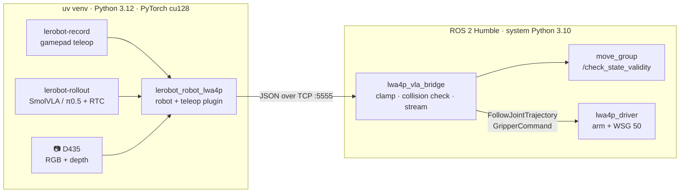

# schunk_vla

Vision-language-action (VLA) policies for the **Schunk LWA 4P** arm with a **WSG 50** gripper and a
wrist **RealSense D435** (RGB + depth), through [LeRobot](https://github.com/huggingface/lerobot).
You record demonstrations with a gamepad, fine-tune **SmolVLA** on this laptop (π0.5 on a bigger GPU),
and run the policy live with **Real-Time Chunking (RTC)**: the policy predicts 50-step action chunks
in a background thread while the arm executes the previous chunk, and each new chunk is guided to
blend into the motion already under way, so there are no pauses at chunk boundaries.

> [!IMPORTANT]
> No open pretrained VLA works zero-shot on the LWA 4P. Their action spaces belong to the robots
> they were trained on (Franka, SO-100, ...), and in a 2026 real-robot benchmark
> ([PhAIL](https://arxiv.org/abs/2605.29710)) none of the tested VLAs worked zero-shot.
> Plan on ~30-50 demonstrations per task, then fine-tuning.



LeRobot 0.7 needs Python ≥ 3.12, while ROS 2 Humble is Python 3.10. So the policy side runs in its own
venv and talks to a small ROS bridge over localhost TCP. Nothing is installed into the system Python.

## Hardware and OS

| | |
|---|---|
| OS | Ubuntu 22.04, ROS 2 Humble |
| GPU | tested on an RTX 5060 Laptop (8 GB, Blackwell); needs CUDA 12.8 wheels (pinned in `pyproject.toml`) |
| Robot | LWA 4P (CANopen on `can0`) + WSG 50 and FTM 75 (`can1`) through a PEAK PCAN-USB Pro |
| Camera | RealSense D435 on the wrist, USB 3 |
| Teleop | Xbox-style gamepad (other layouts: change the axis/button indices in `Lwa4pGamepadConfig`) |

## Repository layout

```
schunk_vla/
├── third_party/lwa4p_driver/   driver, MoveIt config, URDF (submodule, upstream c07db5d)
├── patches/lwa4p_driver/       our changes to the driver, applied by scripts/build_ros.sh
├── ros/lwa4p_vla_bridge/       ROS 2 bridge node + robot.launch.py (real or mock)
├── src/lerobot_robot_lwa4p/    LeRobot plugin: robot `lwa4p`, teleop `lwa4p_gamepad`, `lwa4p-vla` CLI
├── scripts/                    system_setup.sh, build_ros.sh, env.sh, vla.sh
├── config/                     RealSense udev rule
└── tests/
```

## Setup

1. ROS 2 Humble with MoveIt and the driver's Python CAN libraries, as in the
   [driver README](https://github.com/Tomas-Jurov/lwa4p_driver#1%EF%B8%8F%E2%83%A3-install-dependencies)
   (`ros-humble-moveit`, `ros-humble-xacro`, `ros-humble-joint-state-publisher-gui`,
   `pip install --user canopen python-can`), plus [uv](https://docs.astral.sh/uv/).
2. Clone and build:
   ```bash
   git clone --recursive git@github.com:edisimo/schunk_vla.git && cd schunk_vla
   scripts/system_setup.sh up    # sudo: CAN + RealSense udev rules, can0/can1 up, 2 apt packages
   scripts/build_ros.sh          # apply patches/ to the driver, colcon build
   uv sync                       # venv: Python 3.12, PyTorch cu128, LeRobot 0.7 (~6 GB)
   ```
   `scripts/system_setup.sh down` reverts every system change; `status` shows them. It only touches
   the `can0`/`can1` links: Ethernet, Wi-Fi, IP addresses and routes are not changed.
3. Two rules for every terminal:
   - ROS terminals: `. scripts/env.sh` (ROS, workspace, `RMW_IMPLEMENTATION`, `LC_NUMERIC`).
   - venv commands: prefix them with `scripts/vla.sh`. It strips the ROS Python 3.10 paths that a
     sourced ROS environment puts on `PYTHONPATH`, which would otherwise break the 3.12 venv.

## Our changes to the driver

The upstream driver is used unmodified, plus these patches (kept here because they are not
pushed upstream):

**`0001` wrist camera hand-eye calibration.** The measured transform
`arm_tool0` → `camera_color_optical_frame` is stored in
`lwa4p_description/config/camera_calibration.yaml`:

```
T = [  0.00262861   0.99998767  -0.00421341   0.04104811 ]
    [ -0.99982652   0.00255045  -0.01845045   0.03655430 ]
    [ -0.01843948   0.00426118   0.99982090   0.12503844 ]
    [  0            0            0            1          ]
```

The URDF attaches `camera_link`, and `realsense2_camera` publishes `camera_link` → optical frames
from the factory extrinsics. So the file also holds the derived `arm_tool0` → `camera_link`
(xyz `0.041088 0.021557 0.124762`, rpy `1.7979 -1.55187 -1.79531`). It was derived with the
**nominal** D435 transform `camera_link` → `camera_color_optical_frame` (xyz `0 0.015 0`,
rpy `-π/2 0 -π/2`), so expect up to ~0.5 mm and a few tenths of a degree of difference from this
unit's factory values. The Gazebo camera renders from `camera_link` itself, so in simulation the
image sits 15 mm off the real colour sensor.

**`0002` goal preemption for streaming.** A new `FollowJointTrajectory` goal ends the previous one
(as ros2_control's trajectory controller does). Without it, every replaced goal keeps waiting in
an executor thread, so streaming at 10 Hz would exhaust the executor's threads within seconds. The trajectory trace file is also
closed before a new one is opened (it leaked a file handle per goal), and the per-goal log line is
throttled.

**`0003` optional lab fixtures, firmer grasps.** Only the table is modelled by default; the frame,
cap dispenser, racks and holder come back with the xacro arg `lab_fixtures:=true` (modelled but
absent fixtures make MoveIt refuse free space). A grasp blocked by a wider part re-grasps at the
measured width.

**`0004` drive acceleration.** The profile acceleration is 23°/s² instead of 60°/s²: the motor supply
sags above ~0.4 rad/s² (DC-link undervoltage `0x3222`), and streamed targets use the full profile.

**Locale.** With a comma-decimal locale (`LC_NUMERIC=sk_SK.UTF-8`), ROS 2 parses YAML doubles as
strings: RViz's MotionPlanning panel fails with
`parameter '...max_velocity' has invalid type ... setting it to {string}`.
`robot.launch.py` and `scripts/env.sh` set `LC_NUMERIC=en_US.UTF-8`.

## Run

```bash
# terminal 1: driver, gripper, MoveIt, RViz and the bridge (drives start DISABLED)
. scripts/env.sh && ros2 launch lwa4p_vla_bridge robot.launch.py     # mode:=mock without hardware
# terminal 2: someone at the E-stop from here on
. scripts/env.sh
ros2 service call /lwa4p_driver/enable std_srvs/srv/Trigger           # small ±0.5° check per joint
ros2 run lwa4p_driver gripper_cmd home                                # once after power-up
# terminal 3: GPU, bridge and camera status
scripts/vla.sh lwa4p-vla check
```

### 1. Record demonstrations

Step-by-step guide (task design, variation, how many episodes): [docs/data_collection.md](docs/data_collection.md).

```bash
scripts/vla.sh lerobot-record --robot.type=lwa4p --robot.id=lab \
  --teleop.type=lwa4p_gamepad --teleop.grasp_gap_m=0.017 \
  --dataset.repo_id=local/pick_cube --dataset.root=outputs/datasets/pick_cube \
  --dataset.single_task="pick up the red cube and put it in the bin" \
  --dataset.fps=10 --dataset.num_episodes=50 --dataset.episode_time_s=40 \
  --dataset.reset_time_s=20 --dataset.push_to_hub=false --display_data=true
```

| Gamepad | |
|---|---|
| hold **LB** | deadman: the arm moves only while held, and holds position when released |
| hold **RB** too | precision mode, quarter speed (for the final approach to a grasp) |
| left stick | TCP x / y (base frame) |
| right stick | z (vertical), yaw (horizontal) |
| d-pad | roll / pitch |
| **A** / **B** | grasp (45 N) / open the gripper |

`--teleop.grasp_gap_m` is where A closes to: a few mm below the object's width (ampules
~21 mm → 0.017), so the WSG reports HOLDING and keeps the force. With 0 it reports the part as
blocked and lets go. The teleop moves a desired TCP pose and IK tracks it exactly, so the axes
stay independent and releasing LB holds the commanded pose.

Keyboard (LeRobot): → or `n` ends the episode, ← or `r` re-records it, Esc stops. Each frame stores the 6 joint
angles (rad) and the finger gap (m) as state and action, the wrist RGB image (`wrist`), and depth
as a 3-channel image (`wrist_depth`: 0.1-1.0 m, near = bright). VLA vision encoders only take RGB,
so this lets SmolVLA and π0.5 use depth unchanged.

### 2. Fine-tune SmolVLA (on this laptop)

```bash
scripts/vla.sh lerobot-train --policy.path=lerobot/smolvla_base \
  --dataset.repo_id=local/pick_cube --dataset.root=outputs/datasets/pick_cube \
  --rename_map='{"observation.images.wrist": "observation.images.camera1",
                 "observation.images.wrist_depth": "observation.images.camera2"}' \
  --batch_size=16 --steps=15000 --policy.scheduler_decay_steps=15000 --save_freq=5000 \
  --policy.device=cuda --policy.push_to_hub=false \
  --output_dir=outputs/train/smolvla_pick_cube --job_name=smolvla_pick_cube
```

`--rename_map` maps our cameras onto SmolVLA's pretrained camera slots. Batch size 4 used 2.1 GB of
VRAM, so 16 should fit in 8 GB (untested; use 8 if you run out of memory). Aim for 5-10 epochs over the dataset.

### 3. Run it live with RTC

```bash
scripts/vla.sh lerobot-rollout --strategy.type=base \
  --policy.path=outputs/train/smolvla_pick_cube/checkpoints/last/pretrained_model \
  --inference.type=rtc --inference.rtc.execution_horizon=10 --inference.rtc.max_guidance_weight=10.0 \
  --robot.type=lwa4p --robot.id=lab \
  --rename_map='{"observation.images.wrist": "observation.images.camera1",
                 "observation.images.wrist_depth": "observation.images.camera2"}' \
  --task="pick up the red cube and put it in the bin" --fps=10 --duration=120 --device=cuda
```

`--strategy.type=dagger` lets you take over when the policy fails and records the corrections for
the next fine-tune (untested with the gamepad yet).

### π0.5

The plugin works with any LeRobot policy (`--policy.path=lerobot/pi05_base`, same rename map).
π0.5 doesn't fit this laptop, though: fine-tuning needs a 24-40 GB GPU, and loading it here would need
~13.5 GB of RAM (the float32 checkpoint) for ~6.7 GB of bf16 weights on an 8 GB GPU. Train it
elsewhere (needs an HF token with the PaliGemma license accepted), then either run it on a ≥ 12 GB
GPU, or keep this laptop on the robot and serve the policy from the GPU machine with LeRobot's
remote inference (`lerobot-policy-server`, `--inference.type=remote`; see the
[remote inference guide](https://huggingface.co/docs/lerobot/en/remote_inference)). Untested here.

## Safety

- The driver starts with drives disabled; `enable` is always a deliberate step. Keep someone at the
  E-stop for every policy run.
- The bridge sends each target as a short trajectory that ends at that target, so the arm stops
  within 0.5 s when the policy or the venv process dies.
- Every target is rate-limited to 0.45 rad/s against the previous one (at any command rate) and
  kept within 0.5 s of motion of the arm; the teleop also slows down near singular poses
  (≤ 0.3 rad/s per joint). The driver additionally caps 30°/s and 23°/s² and rejects targets beyond
  its joint limits.
- Each target is collision-checked by MoveIt against the workspace model (table, frame, dispenser,
  racks, self-collision). If a target collides, the arm holds and the bridge reports the colliding link pair.

## Tests

```bash
scripts/vla.sh pytest                                           # kinematics, robot vs a fake bridge
. scripts/env.sh && ros2 launch lwa4p_vla_bridge robot.launch.py mode:=mock rviz:=false
scripts/vla.sh lwa4p-vla bench --policy lerobot/smolvla_base    # chunk latency and VRAM
```

Verified on the mock robot (this laptop, 2026-11-10):
- streaming, clamping and collision refusal in the bridge;
- forward kinematics equal to tf2;
- SmolVLA at **158 ms per 50-step chunk, 0.9 GiB VRAM**;
- fine-tuning at batch size 4 within 2.1 GB of VRAM;
- `lerobot-rollout` with RTC at 10 Hz, about 5 ms per action.

Not yet verified: the real arm, the real D435 stream, and the gamepad.

## Troubleshooting

| Symptom | Fix |
|---|---|
| `ModuleNotFoundError` from `/opt/ros/humble/...` in a venv command | run it through `scripts/vla.sh` |
| RViz MotionPlanning: `... is of type {double}, setting it to {string}` | `export LC_NUMERIC=en_US.UTF-8` (`scripts/env.sh` does it) |
| `lwa4p-vla check`: RealSense none found | `scripts/system_setup.sh up`, then replug the camera |
| `bridge refused the action: arm goal rejected` | drives disabled: call `/lwa4p_driver/enable` |
| `bridge refused the action: collision ...` | the target hits the workspace model; move the arm away with the gamepad |
| `waiting for move_group` / no bridge state | all terminals need the same RMW: `. scripts/env.sh` |

## License

MIT, see [LICENSE](LICENSE). The driver submodule is MIT; its arm meshes are LGPL-3.0
(see its README). LeRobot, SmolVLA and π0.5 weights are Apache-2.0.
